# 🌾 Annadata FarmVeda

A human-in-the-loop AI farming companion for Indian smallholder farmers. It advises and helps plan (crop choice, weather-driven timing, climate risk, government schemes) and lets farmers sell directly to consumers, alone or pooled in a cooperative, while final decisions stay with the farmer.

Everything listed under *Features* is implemented and exercised by the automated tests and an end-to-end browser run of the buy/sell flow.

## 📸 Screenshots

| | |
|---|---|
| **Sign in** — demo logins on screen, one-click demo accounts, or create your own<br>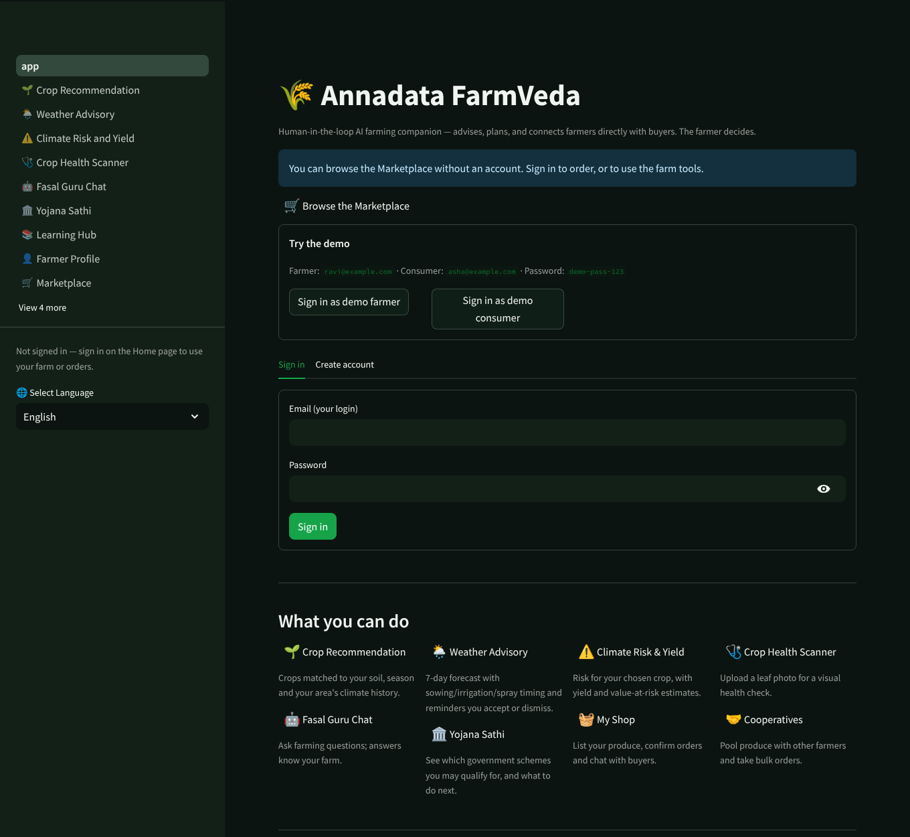 | **Farmer dashboard** — new orders and scheme alerts at a glance<br>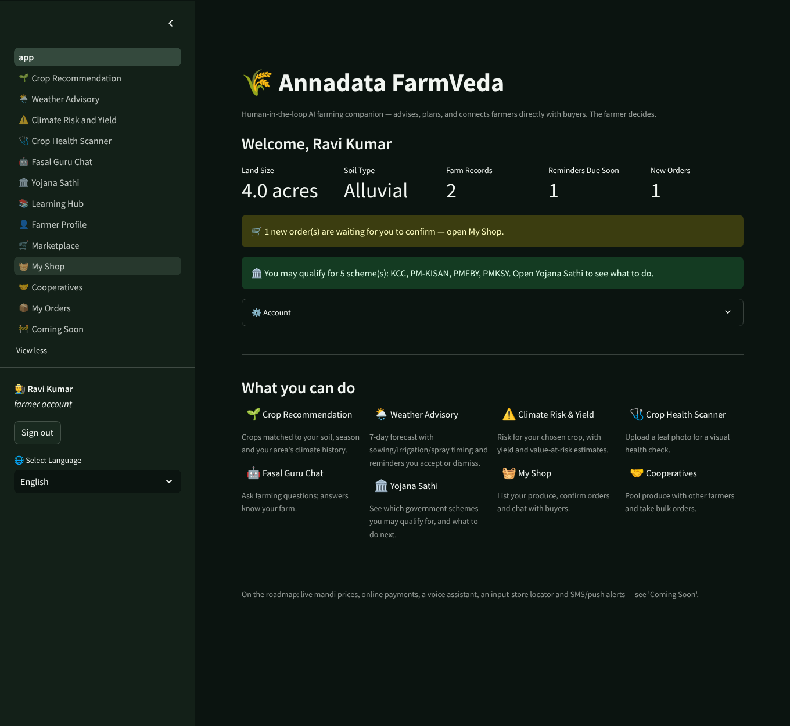 |
| **Marketplace** — browse, search and filter produce straight from farmers<br>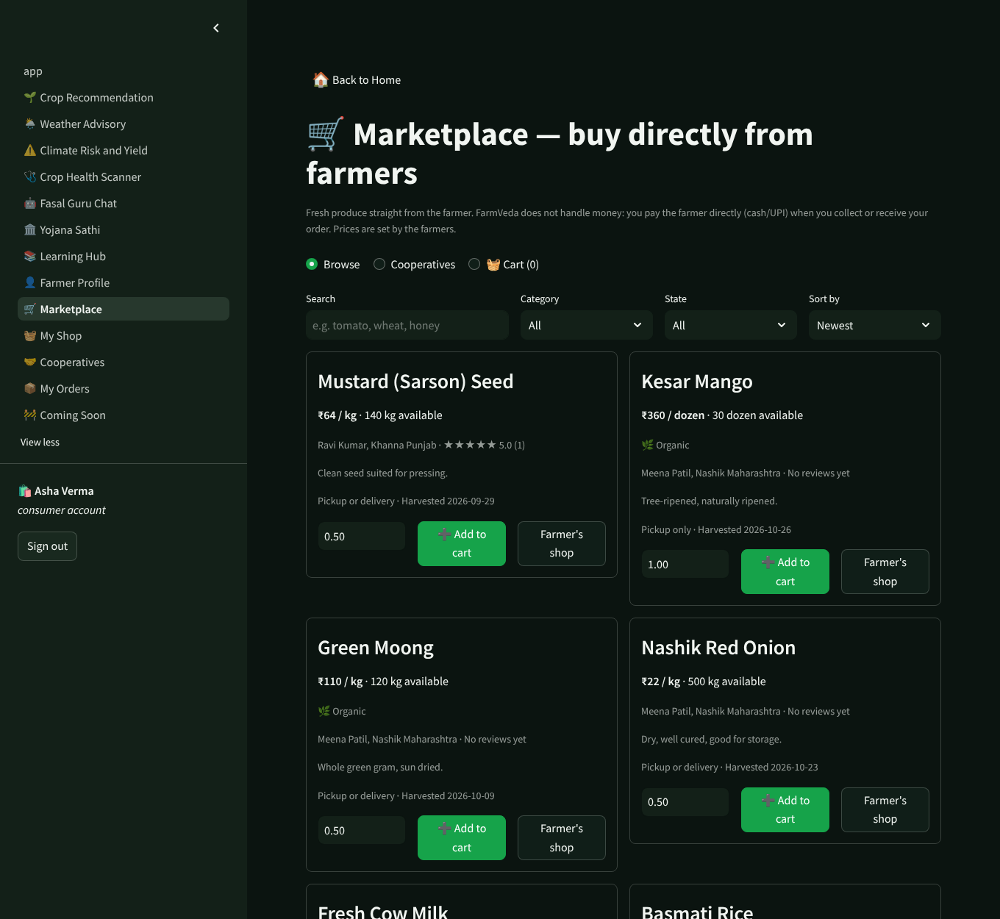 |
| **Farmer's shop** — ratings and reviews from real orders<br>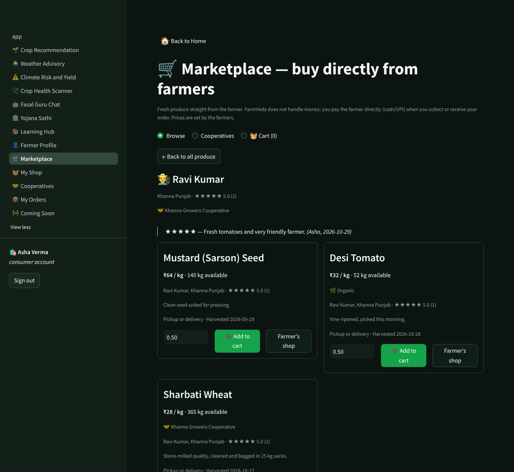 | **Cooperative pooled stock** — one bulk order split across members<br>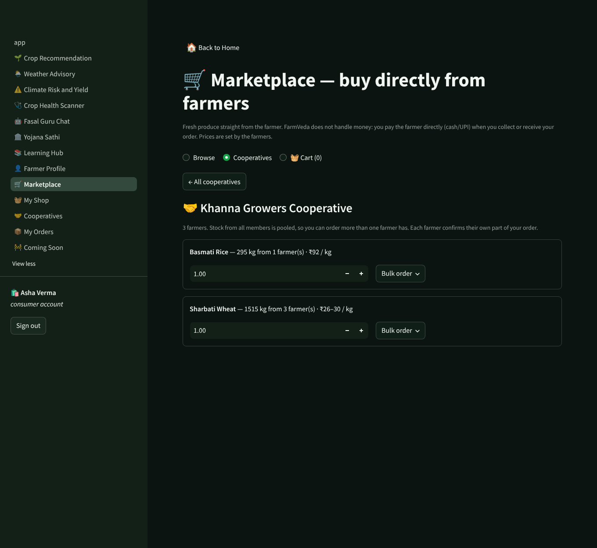 |
| **Cart and checkout** — pay the farmer on pickup or delivery<br>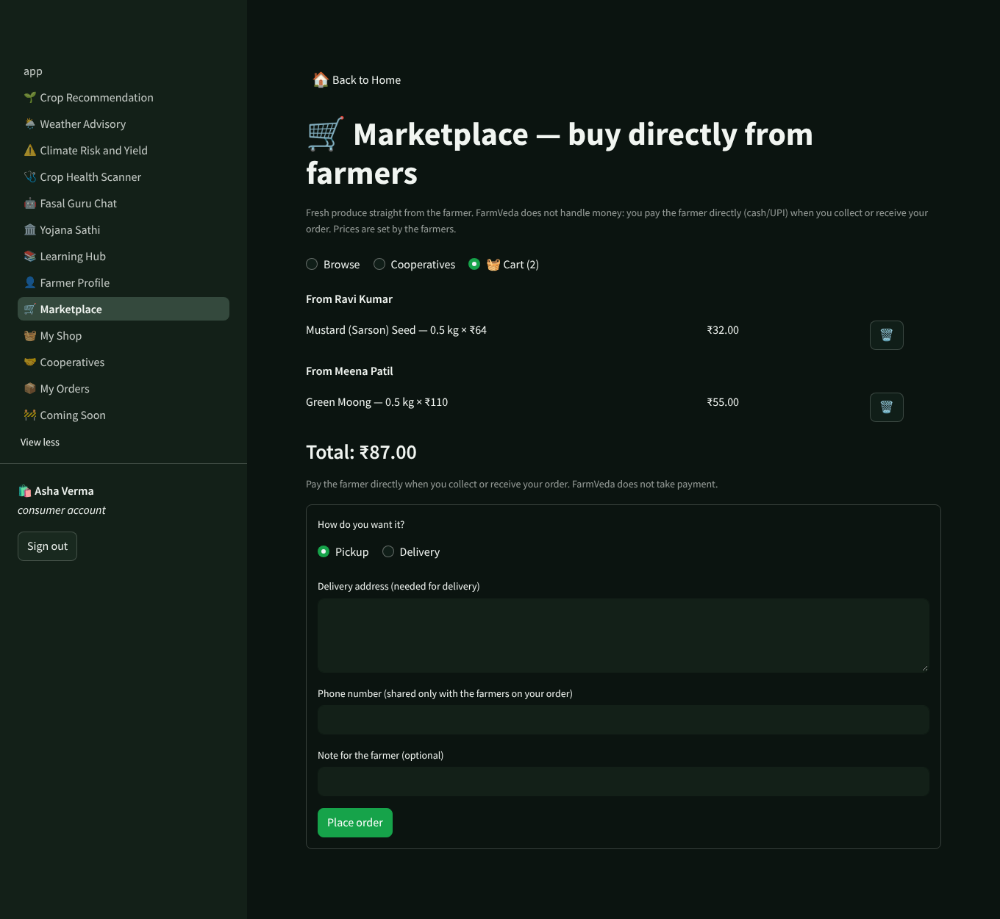 | **My Orders** — status, messages and review in one place<br>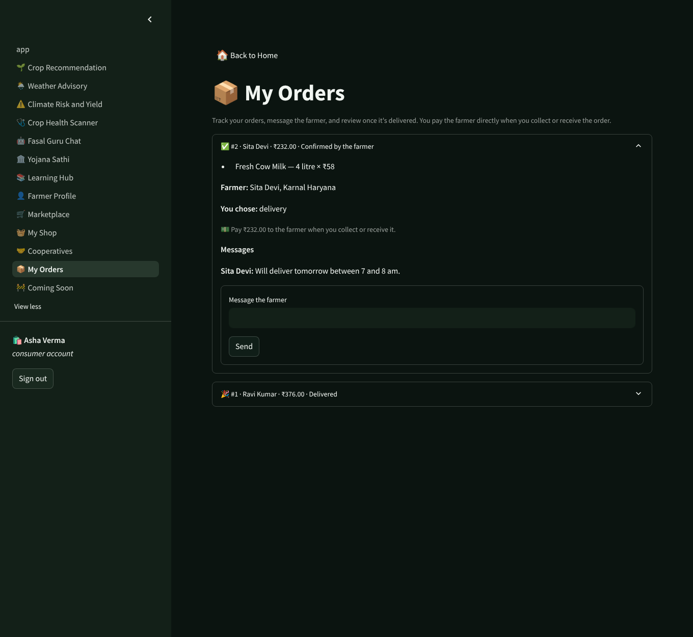 |
| **My Shop** — confirm, reject, deliver and record payment<br>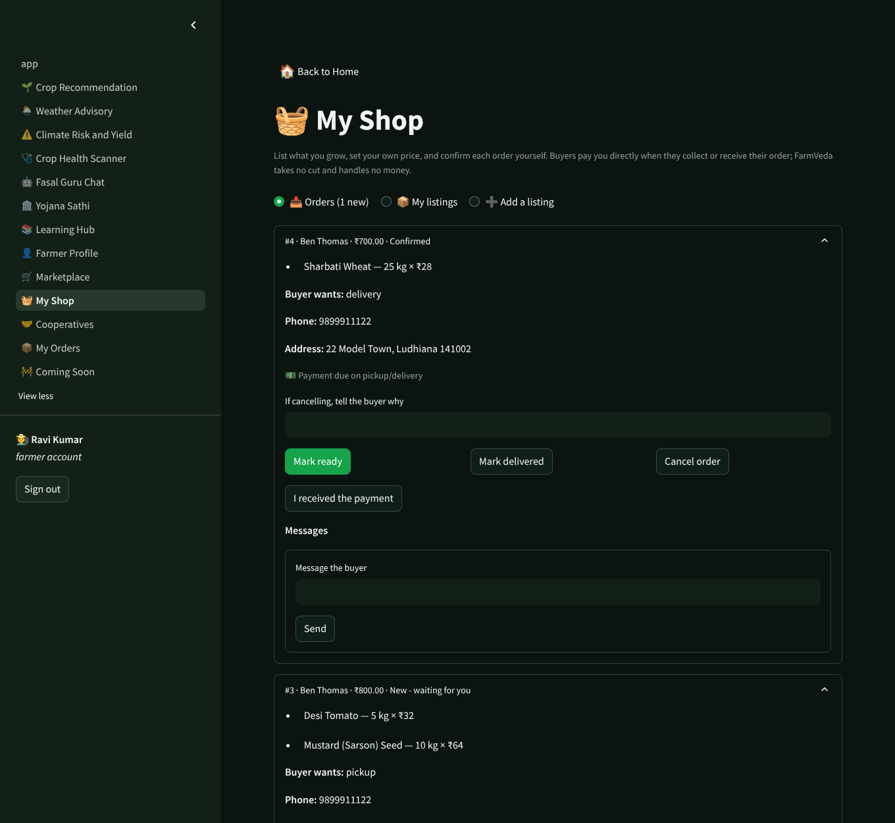 | **Cooperatives** — invite code, roles and pooled stock<br>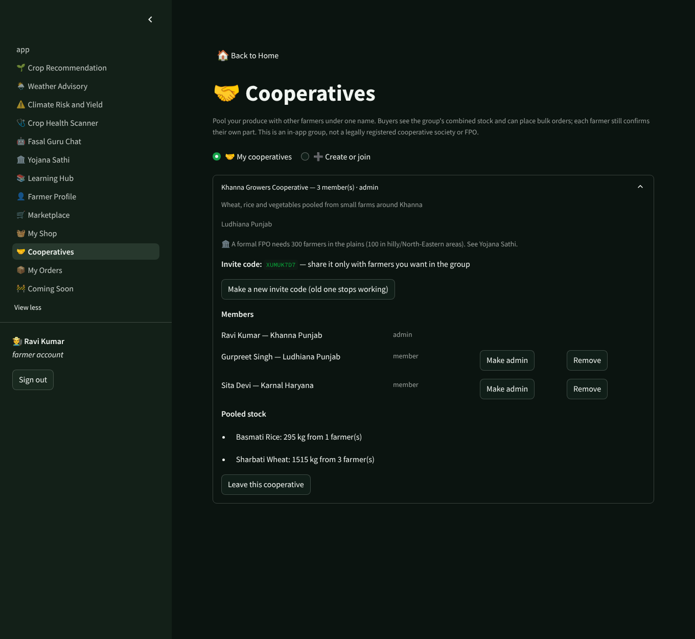 |
| **Yojana Sathi** — schemes sorted by eligibility, with next steps<br>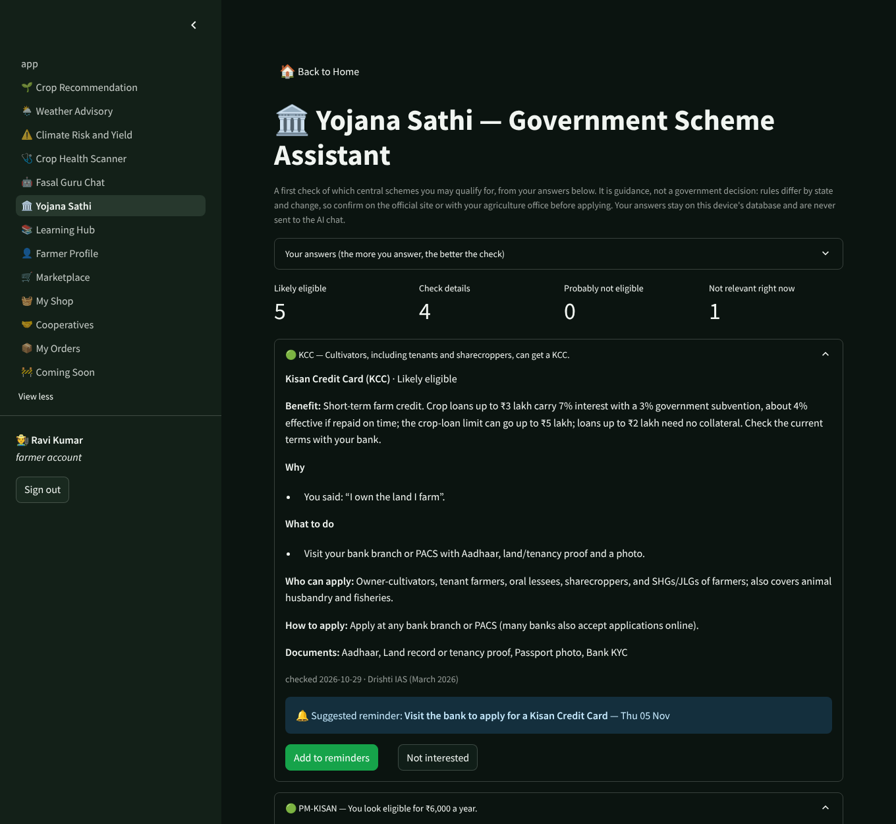 | **Farmer profile** — editable details, reminders, farm records<br>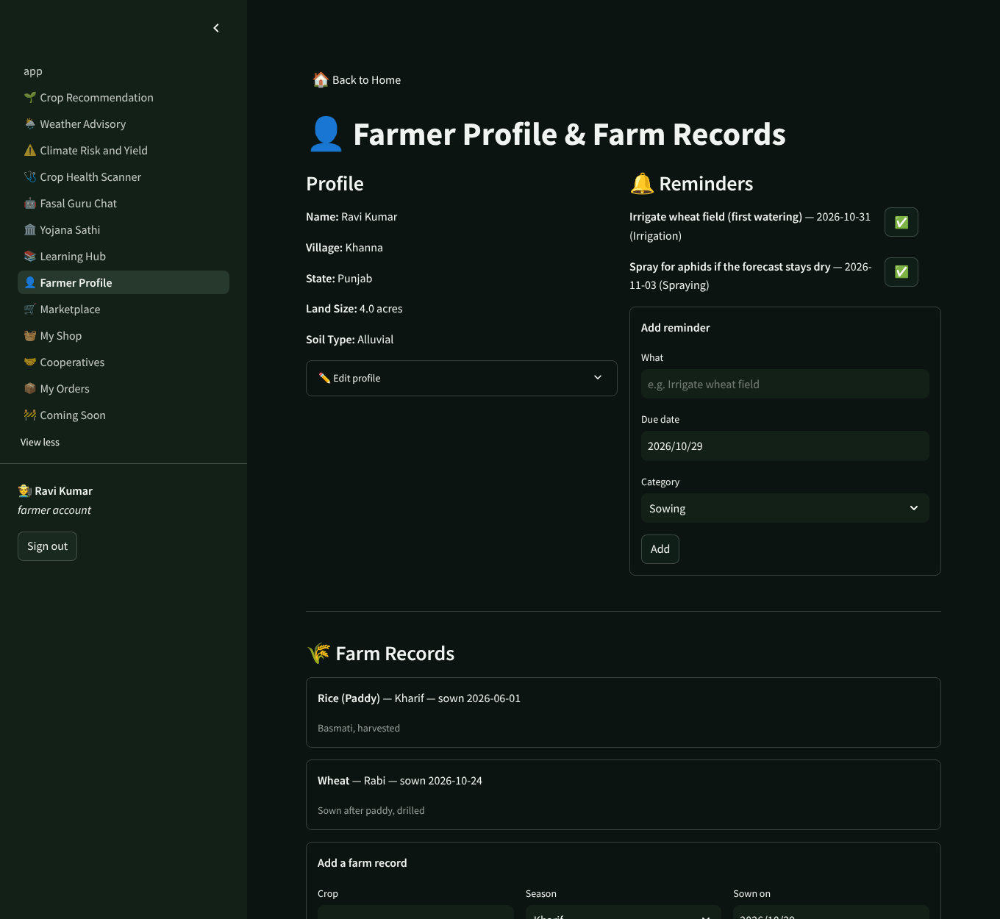 |
| **Works on a phone**<br>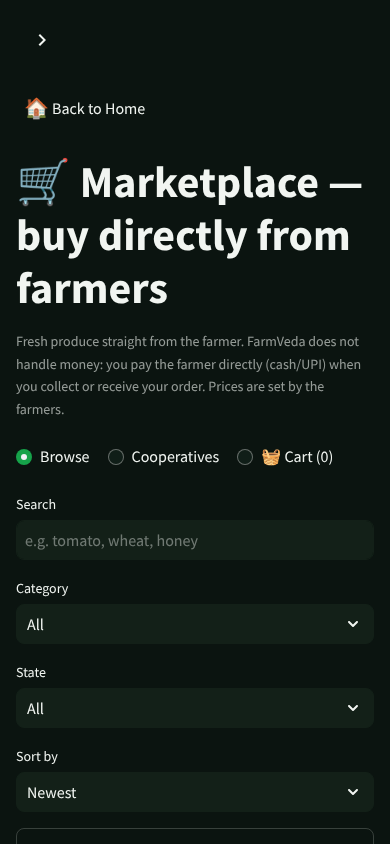 | |

## ✨ Features

| Feature | What it actually does |
|---|---|
| 🌱 **Smart Crop Recommendation** | Rule-based match of your soil type and season against a reference table of 24 Indian crops (Kharif, Rabi and Zaid). Temperature and rainfall come from the **average of the last 3 complete seasons at your location** (Open-Meteo historical data), not from extrapolating one week. If the history can't be fetched it falls back to scaling the 7-day forecast and says so on screen. |
| 🌦️ **Weather-Based Farming Advice** | Live 7-day forecast (Open-Meteo, no API key needed) with rule-based sowing, irrigation, spraying, and harvest timing guidance. Each advisory comes with a **suggested reminder you accept or dismiss** (see Human-in-the-loop below). Same-named villages are disambiguated: you pick from matches shown with district and state. |
| 💧 **Water Management Advisor** | Irrigation timing folded into the Weather Advisory page, driven by the same live forecast. |
| ⚠️ **Climate Risk Prediction** | Heat / cold / heavy-rain / dry-spell / water-gap signals scored from the live forecast. Heat and cold thresholds come from **the selected crop's own temperature range** (36°C stresses wheat, not sugarcane). A one-week dry spell is reported as a dry spell, not a drought. |
| 📉 **Yield Prediction & Loss Prevention Analytics** | Heuristic yield estimate and value-at-risk, derived from climate risk score × a static crop yield/price reference table (clearly labeled as illustrative, not live mandi prices). |
| 🩺 **AI Crop Health Scanner** | Upload a leaf photo — a real HSV color/texture analysis flags likely nutrient deficiency, fungal/pest damage, or water stress, with a treatment recommendation. This is a heuristic, **not** a trained deep-learning disease classifier — see the in-app disclaimer. |
| 🤖 **Fasal Guru (AI Chat)** | Real LLM-backed chat via Google Gemini. Needs your own `GEMINI_API_KEY` (free) — without one, the page explains that clearly instead of faking a response. Answers are grounded in the farmer's village, state, soil, land size, recent crops and (optionally) the live forecast — never their name — and come back in the farmer's chosen language. The model is configurable (`GEMINI_MODEL`) with a fallback chain, because Gemini model names get retired. |
| 🏛️ **Yojana Sathi (Govt. Scheme Assistant)** | A real eligibility check, not a brochure. The farmer answers up to 8 questions (how they farm, land held on 1 Feb 2019, Aadhaar-linked bank account, PM-KISAN exclusions, KCC, livestock, group membership, planned investments); combined with land size, state, crops on record and cooperative membership, 10 schemes are sorted into **likely / check details / unlikely / not applicable**, each with the reasons, the next steps, documents needed, and an official source. Unanswered questions are never treated as "no". Suggested reminders (e.g. PM-KISAN registration, the next PMFBY cut-off) are accepted or dismissed by the farmer, and dismissals are remembered. Every scheme shows its official source and the date its rules were last checked. |
| 📚 **Farmer Learning Hub** | 8 practical guides (crop rotation, IPM, drip irrigation, soil health, post-harvest storage, NPK, climate adaptation, seed treatment). |
| 👤 **Farmer Profile & Farm Records** | Real local SQLite persistence — profile (editable), land/soil details, farm records, and reminders. |
| 🔐 **Accounts** | Email + password sign-up for **farmers** and **consumers**. Passwords are salted scrypt hashes; login errors don't reveal whether an email exists; 5 wrong passwords lock the account for 10 minutes. Your identity comes only from the signed-in account, never from anything the browser can edit. Sign-in survives a page refresh through a server-side session (only a hash of the token is stored; it expires after 12 hours and is revoked on sign-out or password change). Sign out returns you Home, every page has a **Back to Home** link, and you can change your password from the Home page. Anyone can browse the Marketplace without an account; a cart built while signed out follows a consumer into sign-in. |
| 🧺 **My Shop** (farmer) | List produce with your own price and stock, mark it organic, pause or edit it, optionally list under a cooperative. Orders arrive here: confirm or reject (with a reason), mark ready, delivered or cancelled, record payment received, and message the buyer. The buyer's phone and address are shown only to the farmer on that order. |
| 🛒 **Marketplace** (consumer) | Browse and search produce, filter by category/state, sort by price, open a farmer's shop with reviews, add to cart, and check out. Prices come from the database at checkout, stock is reserved atomically (two buyers can't both get the last kilo), and an order that can't be fully filled is not placed at all. One order is created per farmer. |
| 📦 **My Orders** (consumer) | Track each order, cancel while it is still new, message the farmer, and leave one rating and review once it is delivered. Cancelled or rejected orders return their stock. |
| 🤝 **Cooperatives** | Farmers form an in-app group, invite others by code, and share admin roles. Members' listings of the same product are **pooled**, so a consumer can place one bulk order larger than any single farmer holds; it is split across members cheapest-first into separate orders that each farmer confirms for themselves. |
| 🔔 **Smart Notifications** | In-app reminders (sowing, irrigation, spraying, fertilizer, harvest) stored in SQLite; SMS/push delivery is on the roadmap. |
| 🧭 **Advice history** | Every suggestion shown and whether the farmer accepted or dismissed it, on the Farmer Profile page. |
| 🌐 **Regional Language Support** | Live translation (via `deep-translator`) across English, Hindi, Bengali, Telugu, Marathi, Tamil, Gujarati, Kannada, Malayalam, Punjabi, Odia, Assamese, and Urdu — applied to the whole UI, not just a few strings. |

## 🧑‍🌾 Human-in-the-loop, concretely

FarmVeda never acts on its own advice. Weather verdicts and scheme suggestions each carry a *suggested* reminder (title, date, category). Nothing is saved until the farmer presses **Add to reminders**; **Not interested** records that they declined, and that choice persists across sessions. Both decisions go to an `advice_log` table and are shown back on the Farmer Profile page. Accepting creates the reminder and the log row in one transaction. Orders follow the same rule: a farmer's stock is only committed when *they* confirm.

## 🔒 Marketplace rules worth knowing

- **No money moves through FarmVeda.** Payment is cash/UPI between buyer and farmer on pickup or delivery; the farmer records that it was received. There is no gateway, no wallet and no cut.
- Authorization lives in the data layer (`core/market.py`, `core/coop.py`), not the UI. Asking for someone else's order returns the same "not found" as a missing one.
- Order statuses follow a fixed state machine (placed → confirmed/rejected → ready → delivered, with cancellation rules for each side); impossible jumps are refused.
- Text typed by users (listings, messages, reviews, names) is escaped before display, so it cannot inject links, images or HTML.

## 🗺️ Roadmap

Live mandi prices (Agmarknet-style feed), a voice assistant, SMS/push alerts, an input-store locator and online payments are previewed on the in-app **Coming Soon** page.

## Tech stack

- **UI:** Streamlit (multi-page app)
- **Weather:** Open-Meteo (forecast + geocoding, free, no key)
- **AI Chat:** Google Gemini via `google-genai`
- **Translation:** `deep-translator`
- **Image analysis:** Pillow + NumPy (HSV heuristic)
- **Storage:** SQLite (local, no cloud dependency)
- **Passwords:** `hashlib.scrypt` from the standard library

## Tests

```bash
pip install -r requirements.txt pytest
pytest
```

313 tests run with the network faked (canned Open-Meteo responses and a fake Gemini client), including in-process Streamlit runs that click the real buttons (`streamlit.testing`). They cover password hashing and lockout, sign-up/sign-in/sign-out, refresh-proof sessions, change password, demo data, the page guards (signed out, wrong role, forged session ids), listings, atomic stock reservation and checkout, the order state machine and who may see what, cooperative pooling and bulk-order allocation, every scheme-eligibility rule, the accept/dismiss flows, and escaping of user-typed text. The page tests were checked by breaking the code on purpose and confirming they fail. The whole buy/sell journey (two farmers, a cooperative, a consumer, bulk order, confirm, reject, deliver, review) was also driven end to end in a real browser.

## Getting started

```bash
pip install -r requirements.txt
cp .env.example .env   # optional: add GEMINI_API_KEY to enable Fasal Guru chat
streamlit run app.py
```

Opens at `http://localhost:8501` by default.

**Want to look around with data already in it?** Fill the database with a demo world (four farmers, a cooperative, two consumers, listings, orders in every state, reviews) and sign in:

```bash
python scripts/seed_demo.py     # use an empty database; it refuses to touch one that has accounts
streamlit run app.py
```

Farmer: `ravi@example.com` · Consumer: `asha@example.com` · password for every demo account: `demo-pass-123`.

On a brand-new database the Home page offers a **Load demo data** button instead of the script; once the demo accounts exist it shows a **Try the demo** box with these logins and one-click *Sign in as demo farmer / consumer* buttons.

Or start from scratch: create a **farmer** account and a **consumer** account (use two browser profiles or a private window) to try the whole selling flow: the farmer lists produce in My Shop, the consumer orders it from the Marketplace, and the farmer confirms it. `FARMVEDA_DB_PATH` changes where the database file lives. No API keys are required for anything except the AI chat page, which needs a (free) Gemini key. If chat reports that a model isn't found, set `GEMINI_MODEL` in `.env` to one your key can use.

## Project structure

```
app.py                        Home — sign in / create account, role dashboards
core/
  db.py                       SQLite: accounts, farmers, farm_records, reminders, advice_log, listings, orders, cooperatives, reviews
  auth.py                     Accounts: scrypt hashes, lockout, sign-up/sign-in, server-side sessions
  demo.py                     Demo world used by the seed script and the Try-the-demo box
  market.py                   Listings, cart pricing, atomic checkout, order state machine, messages, reviews
  coop.py                     Cooperatives, pooled stock, bulk-order allocation
  eligibility.py              Scheme-eligibility rules (likely / check / unlikely / n/a)
  safe.py                     Escaping for user-typed text
  i18n.py                     Live translation (13 languages)
  weather.py                  Open-Meteo geocoding/forecast + advisory rules
  advice.py                   Advisory verdict -> suggested reminder (accept/dismiss)
  climate.py                  Seasonal normals from Open-Meteo historical data
  location_picker.py          Place picker + cached lookups for the pages
  crop_recommender.py         Rule-based crop matching
  risk_yield.py                Crop-specific climate risk + yield + loss heuristics
  health_scanner.py            Leaf photo HSV heuristic analysis
  chat.py                      Fasal Guru (Gemini-backed)
  schemes.py                   Scheme reference data loader
  state.py                     Shared Streamlit session helpers
data/
  crop_requirements.csv        24 crops: soil/season/temp/rainfall ranges
  crop_yield_price_reference.csv  Illustrative yield & price reference
  schemes.json                 10 central schemes with how-to-apply, documents, source and check date
  learning_content.json        8 farming practice guides
pages/                         One file per feature (Streamlit auto-routes these); 10-13 are Marketplace, My Shop, Cooperatives, My Orders
scripts/seed_demo.py           Demo data for a populated first run
docs/screenshots/              Images used in this README
tests/                         pytest suite (network faked); test_pages_*.py drive the real pages
```

## Disclaimer

FarmVeda is a planning aid. Advisories and scheme checks are guidance; confirm scheme terms on the official site and use your local Krishi Vigyan Kendra for field decisions.
